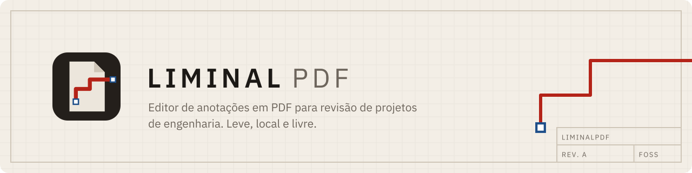

<p align="center">
  <picture>
    <source media="(prefers-color-scheme: dark)" srcset="docs/brand/banner-dark.svg">
    
  </picture>
</p>

<p align="center">
  <a href="LICENSE"></a>
  
  
</p>

<p align="center"><b>O melhor programa é o que não existe.</b></p>

O LiminalPDF quer ser isso: nenhuma impedância entre você e o seu trabalho. Abre rápido, marca o que precisa e sai da frente. Leve, prático, útil. Livre (MIT), local, sem conta e sem nuvem.

É um editor de anotações em PDF pensado para revisão de projetos de engenharia: unifilares, malhas, diagramas, memoriais. O PDF original nunca é alterado; as marcações ficam num `.json` ao lado dele.

**O que faz**

- Linhas e polilinhas com de–para (origem, destino, função, circuito, status), travamento em 45° com Shift e vértices editáveis
- Áreas, caixas de texto e marca-texto (sobre o texto ou em área livre)
- Lista das marcações por tipo, com notas, sempre à vista
- **Montar PDF**: junta páginas de vários arquivos, em qualquer ordem, num PDF novo
- Três temas (sépia, claro e escuro); a página do PDF continua branca em todos

## Por que existe

Revisão de projetos (unifilares, malhas, diagramas) pede zoom estável e traços com origem, destino, função, circuito e status. Essas propriedades são genéricas de propósito: servem tanto para um sinal de proteção quanto para um cabo, um duto ou qualquer outro vínculo entre dois pontos.

Sem Qt e sem Electron: um executável de poucos MB que usa o motor web que já vem no sistema (WebView2 no Windows, WebKit no Linux e no macOS), via [Tauri](https://tauri.app).

## Uso

**Windows, sem administrador:** baixe da página de [Releases](../../releases). `liminalpdf.exe` é portátil: copie para um pendrive ou para Documentos e dê dois cliques. Precisa do WebView2, que já vem no Windows 10 e 11. O instalador (`LiminalPDF_x.y.z_x64-setup.exe`) instala só para o usuário atual, também sem admin, e registra o LiminalPDF em "Abrir com…" para PDFs.

No app:

- Abrir `desenho.pdf` carrega automaticamente `desenho.liminal.json`, se existir na mesma pasta.
- `Ctrl+S` grava direto nesse arquivo (de forma atômica: um temporário é renomeado por cima, então uma queda no meio não corrompe o anterior).
- Arrastar um PDF ou um `.json` sobre a janela abre o arquivo.
- Fechar a janela com alterações não salvas pede confirmação.

**Linux e macOS:** também na página de [Releases](../../releases): `.AppImage` (portátil) e `.deb` para Linux, `.dmg` para macOS.

## Ferramentas

| Atalho | Ferramenta | Uso |
| --- | --- | --- |
| `V` | Selecionar | Clique seleciona, arraste move a marcação; arraste no vazio faz pan |
| `L` | Linha | Clique e arraste |
| `P` | Polilinha | Clique nos vértices; Enter ou duplo-clique termina; Backspace desfaz o último vértice |
| `R` | Área | Retângulo |
| `T` | Texto | Clique (caixa padrão) ou arraste (tamanho livre) e digite; Esc conclui |
| `H` | Marca-texto | Arraste sobre o texto para destacar as linhas; fora do texto (ou com `Alt`) marca uma área livre |
| `Shift` | Travar | Linha, polilinha, vértices e mover: 0°/45°/90°. Área: quadrado |
| roda | Rolar | Rola a página (Shift+roda rola na horizontal) |
| `Ctrl`+roda / pinça | Zoom | Ancorado no ponto sob o cursor |
| `Ctrl` `+` / `-` / `0` | Zoom | Ampliar, reduzir, ajustar à largura |
| espaço / botão do meio | Pan | Mesmo com outra ferramenta ativa |
| setas | Mover | Move a seleção 1 px (Shift: 10 px) |
| `Ctrl+M` | Montar PDF | Abre a janela de mesclar e escolher páginas |
| `Ctrl+S` / `Ctrl+Shift+S` | Salvar / Salvar como | No Edge/Chrome, grava sempre no mesmo `.liminal.json` |
| `Ctrl+Z` / `Ctrl+Y` | Desfazer / Refazer | |
| `Del` | Excluir | Marcação selecionada |

### Marca-texto

Funciona como nos leitores de PDF: arrastar sobre o texto destaca exatamente os caracteres entre o início e o fim, linha a linha, e guarda o trecho destacado, que aparece na aba **Marca-texto** da lista. Começar o arraste fora do texto, ou segurar `Alt`, marca uma área retangular livre (útil em desenhos, tabelas escaneadas e carimbos). A cor e a opacidade têm paleta própria de tons claros; o destaque fica por baixo das outras marcações e não esconde o texto. PDFs escaneados sem camada de texto só aceitam o modo área.

### Montar PDF

O botão **Montar PDF…** (ou `Ctrl+M`) abre uma segunda janela para criar um PDF novo a partir de páginas de vários arquivos. Os originais não são alterados.

1. Adicione os arquivos (botão, `Ctrl+O` ou arrastando). O documento aberto no editor já entra como primeiro arquivo, e cada arquivo adicionado vira um trecho com todas as páginas.
2. Em cada trecho, escolha o arquivo e digite as páginas na ordem desejada: `1-5, 7, 9` · `45-66` · `10-fim` · `5-1` (invertido). Vazio = todas. **Escolher…** abre as miniaturas para marcar com o mouse (Shift+clique marca um intervalo).
3. O mesmo arquivo pode entrar em quantos trechos quiser: use **+ Trecho** ao lado do arquivo ou **⧉** para duplicar um trecho.
4. Reordene arrastando pela alça `⋮⋮` ou com ↑ ↓.
5. **Gerar PDF…** (`Ctrl+S`) salva o resultado e, com **Abrir no editor** marcado, já o abre na janela principal.

Exemplo: `pdf1` páginas `1-5, 7, 9` → `pdf2` páginas `45-66` → `pdf1` páginas `4, 6, 8, 92` gera um PDF de 33 páginas nessa ordem.

### Edição de vértices

Com uma marcação selecionada aparecem alças nos vértices (linha, polilinha) ou cantos (área, texto). Arraste uma alça para reposicionar; com `Shift` o segmento trava em 45° em relação ao vértice vizinho. Na polilinha, duplo-clique num segmento insere um vértice e duplo-clique numa alça remove.

### Estilo

O painel lateral ajusta cor, espessura (em pt, acompanha o zoom) e opacidade da seleção. Sem nada selecionado, ajusta o estilo padrão da próxima marcação. Caixas de texto têm ainda cor e tamanho do texto, cor e opacidade do fundo, e moldura (cor, espessura, opacidade; espessura 0 = sem moldura).

Linhas e polilinhas carregam o de–para (origem, destino, função, circuito, status e nota). Áreas e caixas de texto têm nota. A lista inferior tem uma aba por tipo (Linha, Polilinha, Área, Texto); selecionar uma marcação abre a aba dela, e clicar numa linha da lista seleciona a marcação na página.

## Arquivo de marcações

```json
{
  "format": "liminalpdf",
  "version": 2,
  "pdfName": "desenho.pdf",
  "marks": []
}
```

Arquivos da versão 1 abrem normalmente; marcações sem estilo recebem o padrão.

## Desenvolvimento

Requisitos: Node.js 20+ e Rust. **Passo a passo para Windows em [docs/compilar-no-windows.md](docs/compilar-no-windows.md).** No Linux e no macOS, veja os [pré-requisitos do Tauri](https://tauri.app/start/prerequisites/).

```bash
npm install
npm run desktop          # janela do app com recarga automática
npm run desktop:build    # gera o executável e os instaladores
npm run dev              # só a interface, no navegador
```

Saídas do `desktop:build`:

- `src-tauri/target/release/liminalpdf.exe`: executável portátil
- `src-tauri/target/release/bundle/nsis/`: instalador por usuário (sem admin)

Sem instalar Rust: o workflow [`.github/workflows/release.yml`](.github/workflows/release.yml) compila para Windows, Linux e macOS no GitHub Actions. Rode-o manualmente na aba Actions (os arquivos ficam na execução) ou envie uma tag `v*` para gerar um rascunho de Release.

### Estrutura

| Pasta | Conteúdo |
| --- | --- |
| `src/` | Interface (TypeScript + pdf.js). `desktop.ts` é a ponte com a parte nativa |
| `src/merge/` | Janela Montar PDF (`merge.html`): seleção de páginas e mesclagem com [pdf-lib](https://github.com/cantoo-scribe/pdf-lib) |
| `src-tauri/` | Casca nativa em Rust: janela, diálogos, leitura e escrita de arquivos |
| `docs/brand/` | Logo, banner e imagem social. Gerados por `npm run brand`; ver [docs/identidade.md](docs/identidade.md) |
| `src-tauri/capabilities/` | Permissões da janela. A interface só acessa o disco pelos comandos `read_pdf`, `read_marks`, `write_marks` e `write_pdf`, que aceitam apenas `.pdf` e `.json` |

## Licença

MIT. Ver [LICENSE](LICENSE). A fonte IBM Plex Sans, embutida no app, é distribuída sob a SIL Open Font License 1.1.

Identidade visual, paleta dos temas e uso do logo: [docs/identidade.md](docs/identidade.md).
