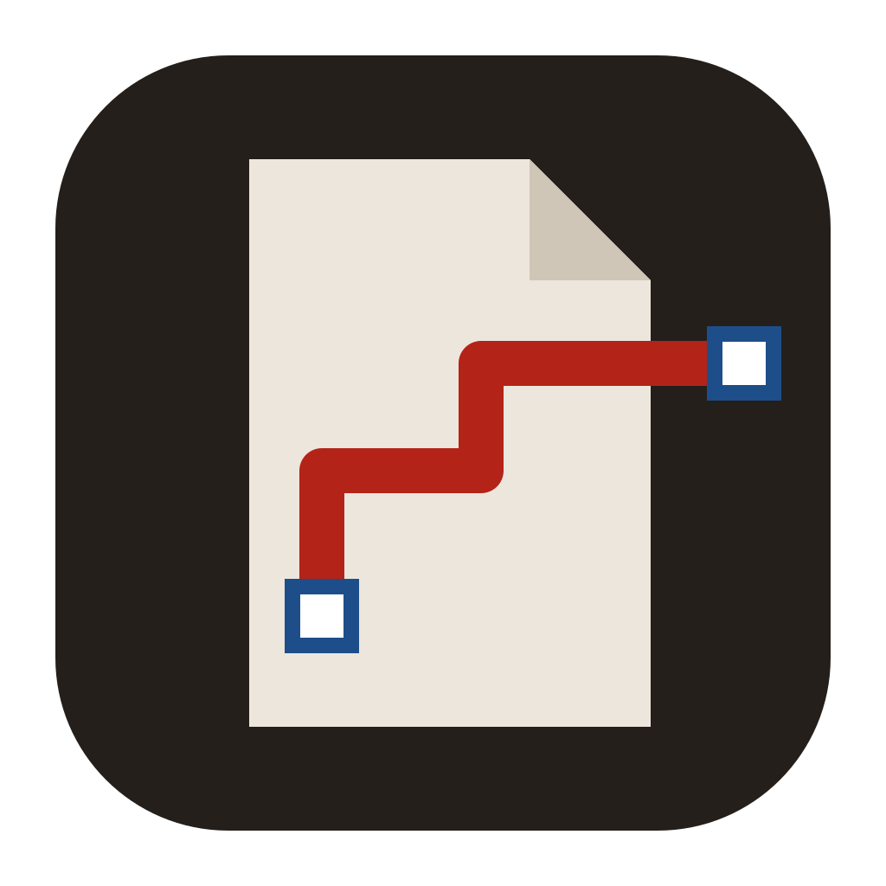
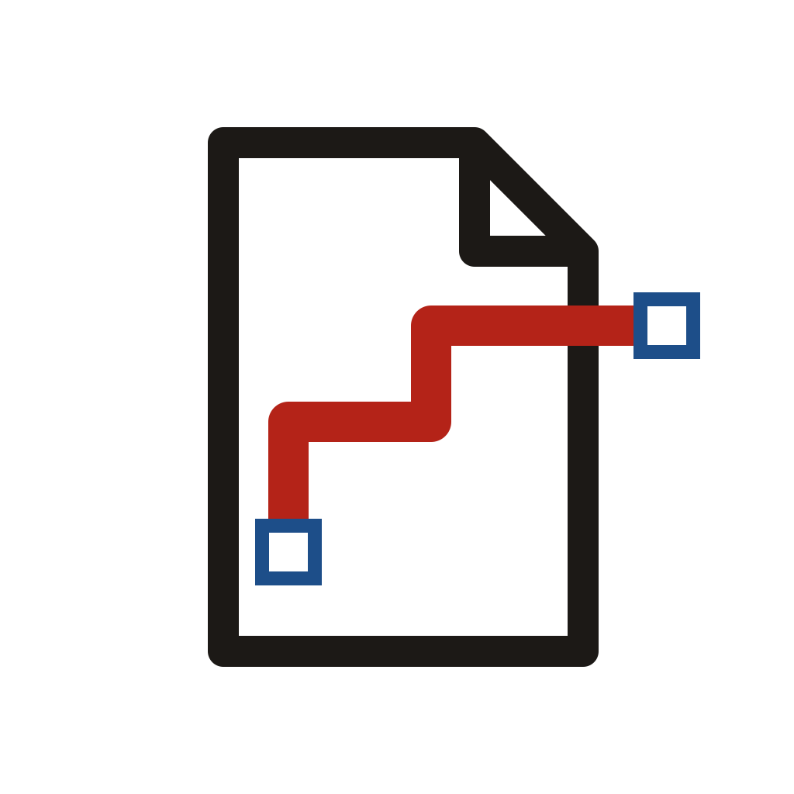
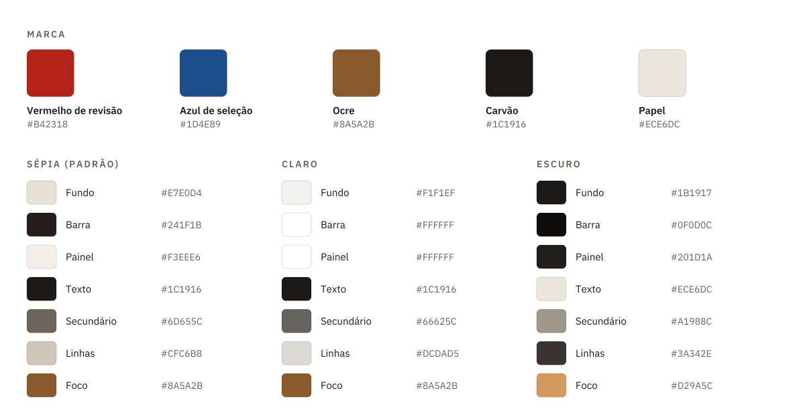

# Identidade visual do LiminalPDF

<picture>
  <source media="(prefers-color-scheme: dark)" srcset="brand/logo-dark.svg">
  
</picture>

## Conceito

*Liminal* vem de limiar: a fronteira entre dois estados. No LiminalPDF, essa fronteira separa o desenho original da revisão feita sobre ele. O PDF nunca é alterado e as marcações vivem numa camada à parte.

O símbolo mostra exatamente isso. Uma folha de desenho com a dobra no canto, e sobre ela uma **polilinha de revisão em vermelho** que atravessa a borda da folha. Os **quadrados azuis** nas pontas são as alças de edição, como aparecem no próprio programa: a marcação continua viva, pode ser ajustada.

Os materiais de divulgação (banner e imagem social) usam o vocabulário da prancha técnica: grade de fundo, moldura e um carimbo no canto inferior direito.

## Logo

| Arquivo | Uso |
| --- | --- |
| [`brand/simbolo.svg`](brand/simbolo.svg) | Símbolo com fundo. Ícone do app, favicon e avatar |
| [`brand/simbolo-contorno-escuro.svg`](brand/simbolo-contorno-escuro.svg) | Só o traço, para fundos claros e tamanhos pequenos |
| [`brand/simbolo-contorno-claro.svg`](brand/simbolo-contorno-claro.svg) | Só o traço, para fundos escuros |
| `brand/logo-{sepia,light,dark}.svg` | Símbolo + nome, horizontal, um por tema |
| `brand/wordmark-{sepia,light,dark}.svg` | Só o nome |
| `brand/banner-{sepia,light,dark}.svg` | Topo do README (o GitHub troca claro/escuro sozinho) |
| [`brand/social-preview.png`](brand/social-preview.png) | Imagem de compartilhamento do repositório (1280×640) |

<p>
  
  &nbsp;
  
</p>

**Área de proteção:** deixe livre ao redor do logo pelo menos 1/4 da altura do símbolo.

**Tamanho mínimo:** 16 px para o símbolo com fundo e 24 px de altura para o logo horizontal. Abaixo de 32 px, prefira o símbolo sem o nome.

**Evite:**

- mudar as cores da polilinha ou das alças;
- girar, distorcer ou aplicar sombra;
- trocar a fonte do nome;
- colocar o símbolo com fundo escuro sobre fundo escuro sem o contorno (as versões `dark` já têm o contorno).

## Cores



### Marca

| Nome | Hex | Papel |
| --- | --- | --- |
| Vermelho de revisão | `#B42318` | Cor padrão das marcações; a polilinha do símbolo |
| Azul de seleção | `#1D4E89` | Seleção e alças de edição |
| Ocre | `#8A5A2B` | Foco, destaques e controles ativos |
| Carvão | `#1C1916` | Texto e fundo do símbolo |
| Papel | `#ECE6DC` | A folha do símbolo |

O vermelho e o azul são iguais nos três temas, porque aparecem sobre a página do PDF, que é sempre branca.

### Temas da interface

O app tem três temas, escolhidos na barra superior e lembrados entre sessões. **Sépia** é o padrão.

| Token | Sépia | Claro | Escuro |
| --- | --- | --- | --- |
| Fundo da área de trabalho | `#E7E0D4` | `#F1F1EF` | `#1B1917` |
| Barra superior | `#241F1B` | `#FFFFFF` | `#0F0D0C` |
| Texto da barra | `#ECE6DC` | `#1C1916` | `#ECE6DC` |
| Painel lateral | `#F3EEE6` | `#FFFFFF` | `#201D1A` |
| Texto | `#1C1916` | `#1C1916` | `#ECE6DC` |
| Texto secundário | `#6D655C` | `#66625C` | `#A1988C` |
| Linhas e divisórias | `#CFC6B8` | `#DCDAD5` | `#3A342E` |
| Foco | `#8A5A2B` | `#8A5A2B` | `#D29A5C` |
| Perigo (Excluir) | `#8F1D18` | `#B42318` | `#F08A7E` |

A fonte da verdade é [`src/style.css`](../src/style.css) (`:root[data-theme="…"]`). O texto secundário tem contraste de pelo menos 4,5:1 sobre o painel em todos os temas.

### Cores rápidas das marcações

`#B42318` · `#1D4E89` · `#1F7A3A` · `#C4620A` · `#7A2A8C` · `#0E7C86` · `#1C1916` · `#E5B400`

## Tipografia

**[IBM Plex Sans](https://github.com/IBM/plex)**, licença SIL Open Font License 1.1, embutida no app, sem download.

- Interface: Regular 400 e SemiBold 600, 13 px base.
- Nome: `LIMINAL` em SemiBold e `PDF` em Regular na cor secundária, ambos em caixa alta com espaçamento de 0,14 em.
- Rótulos de seção (MARCAÇÃO, ESTILO, RELAÇÕES): SemiBold 11 px, caixa alta, espaçamento de 0,08 em.

Nos arquivos SVG os textos estão convertidos em curvas, então aparecem iguais em qualquer lugar, inclusive no GitHub.

## Publicação no GitHub

1. **Imagem social:** *Settings → General → Social preview → Edit → Upload an image* e escolha `docs/brand/social-preview.png`.
2. **Avatar ou ícone da organização:** use `docs/brand/simbolo-512.png`.
3. O banner do README já alterna entre a versão sépia e a escura conforme o tema de quem visita.

## Regenerar

Tudo sai de um único script, com as cores e as formas definidas em código:

```bash
npm install
npm run brand                           # docs/brand/* e public/favicon.svg
npx tauri icon docs/brand/icone-1024.png # ícones do app em src-tauri/icons/
```

`tauri icon` também cria pastas `android/`, `ios/` e arquivos `Square*.png` em `src-tauri/icons/`. Podem ser apagados: o app só usa os arquivos listados em `tauri.conf.json`.
